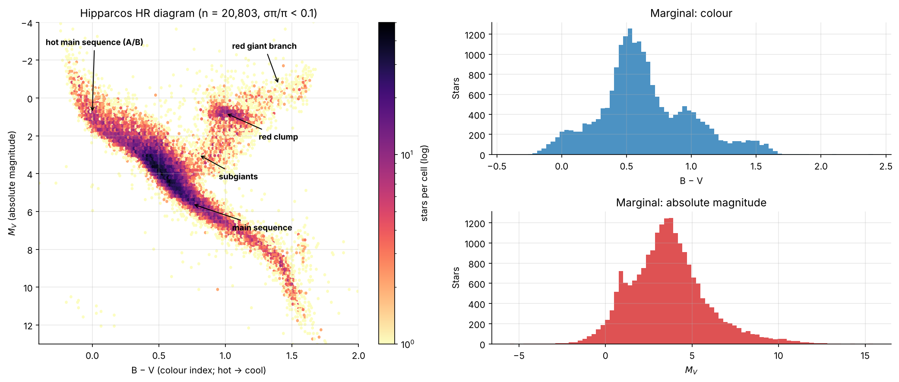
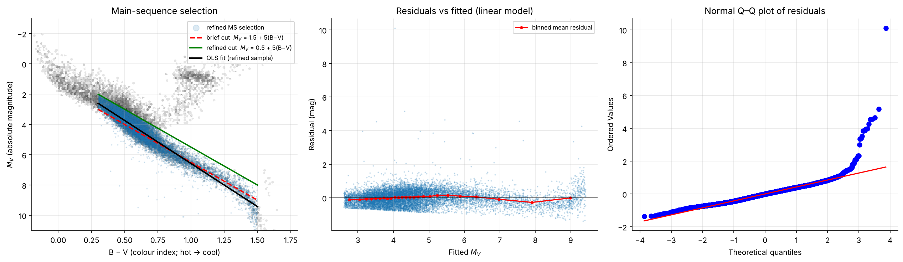
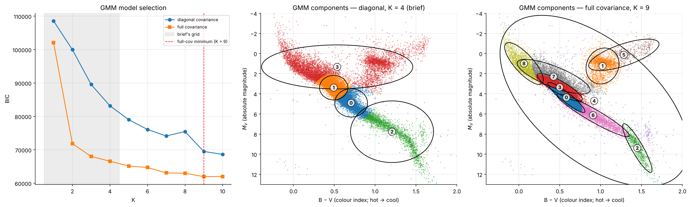
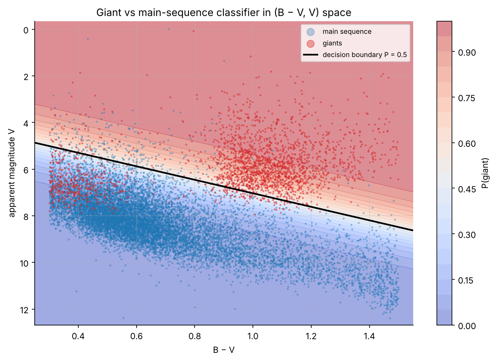
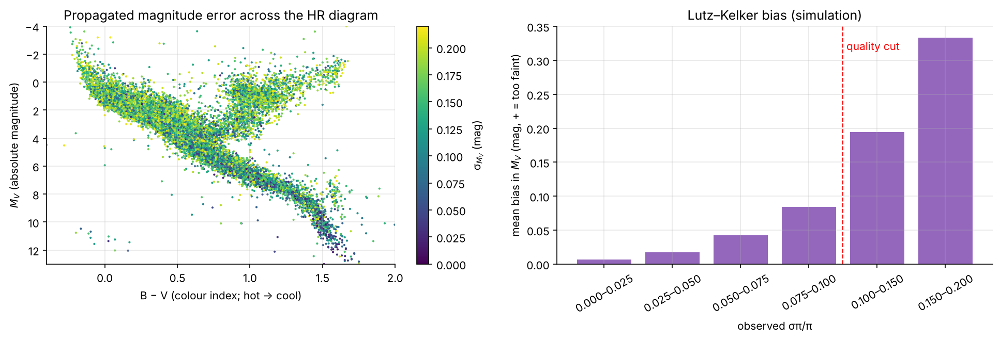

# The Hertzsprung–Russell Diagram from Hipparcos: Statistical Modelling of Stellar Populations

Statistical modelling of 20,803 nearby stars with precise parallaxes from the ESA Hipparcos catalogue:
maximum-likelihood and Bayesian estimation, regression with careful sample selection, classification for a
standard-candle use case, model selection with AIC/BIC, Gaussian mixtures, Monte Carlo simulation, and
measurement-error propagation including selection bias.

*MSc Machine Learning, University of Thessaly · Mathematical Modelling II, 2025–26*

**Stack:** Python · pandas · NumPy · SciPy · scikit-learn · Matplotlib · astroquery



---

## Key results

| Question | Answer |
|---|---|
| Does the suggested main-sequence selection work? | **No.** The line $M_V > 1.5 + 5(B-V)$ runs along the ridge of the main sequence and discards its brighter half, so the regression partly recovers the cut itself. Moving the boundary 1 mag brighter keeps **12,337 stars instead of 4,551** and gives slope **5.69 ± 0.02** (vs 5.30). |
| Is the main sequence a straight line? | Close (R² = 0.92), but **AIC and BIC both prefer a cubic** (ΔAIC = −353, ΔBIC = −338). The local slope ranges from 7.1 (F stars) to 5.2 (K stars): the mass–luminosity relation in action. |
| Can giants be told apart from dwarfs using only colour and apparent magnitude? | **AUC-ROC 0.96.** For a clean standard-candle sample, a threshold of 0.92 gives **96% precision** (10 dwarfs among 244 selected giants). Apparent magnitude works only because the parallax cut makes the sample distance-limited. |
| How many populations does a Gaussian mixture find? | With diagonal covariances BIC never stops improving (misspecification). With **full covariances it has a clear minimum at K = 9**, recovering the hot MS, the main-sequence segments, the **red clump** and the **red giant branch**. |
| How much do parallax errors matter? | $\sigma_{M_V}\approx 2.17\,\sigma_\pi/\pi$, i.e. **0.22 mag at the 10% cut** (median 0.14 mag). A simulation shows the **Lutz–Kelker bias** makes stars inside the cut ≈ 0.06 mag too faint on average. |

## Highlights

**Sample selection drives the result.** Red dashed: the suggested cut. Green: the refined cut. Black: the fit on the refined sample.



**Stellar populations recovered without labels.** Diagonal vs full-covariance Gaussian mixtures.



**Classifier for a standard-candle sample** (decision boundary in colour and apparent-magnitude space)



**Parallax-error propagation and Lutz–Kelker bias**



## What's inside

| # | Task | Methods |
|---|------|---------|
| 1 | HR diagram & marginal distributions | moments; 1-D Gaussian mixtures with BIC |
| 2 | Solar-colour stars as $\mathcal N(\mu,\sigma^2)$ | MLE derivation, bias of $\hat\sigma^2$, Q–Q plot, normality test |
| 3 | Bayesian estimate of $\mu$ | Gaussian–Gaussian conjugate update, prior-strength sensitivity |
| 4 | Main-sequence relation | ridge analysis to refine the selection, OLS from the normal equations, diagnostics |
| 5 | Giant vs main-sequence classifier | L2 logistic regression, 5-fold CV, decision boundary |
| 6 | Evaluation | ROC/PR, F0.5 and 95%-precision thresholds chosen on out-of-fold predictions, loss curves |
| 7 | Linear vs cubic main sequence | AIC & BIC derived from the Gaussian likelihood; local slope analysis |
| 8 | Stellar populations | EM for Gaussian mixtures (diagonal vs full covariance), BIC |
| 9 | P(G star brighter than the Sun) | Gaussian CDF vs Monte Carlo, convergence rate |
| 11 | Parallax-error propagation | delta method, Monte Carlo sensitivity of Tasks 2/4, Lutz–Kelker simulation |

Every task in the notebook includes the derivation, the code, and an astrophysical interpretation of the numbers.
Task 10 of the original brief (time-series analysis of the Mira light curve) was optional and is not included.

## Findings worth discussing

* **Selection effects everywhere.** The suggested main-sequence cut truncates the sample along the very relation being fitted. Apparent magnitude predicts "giant" only because the parallax-quality cut makes the sample distance-limited. Solar-colour stars average 0.58 mag *brighter* than the Sun because of subgiants and Malmquist bias. The parallax cut itself induces the Lutz–Kelker bias.
* **A model that keeps improving can be a sign of misspecification.** Diagonal Gaussians cannot follow the tilted main sequence, so BIC keeps rewarding more components. Allowing full covariances improves BIC by 16,600 at the same K and gives a genuine optimum.
* **Choose the decision threshold for the use case.** For standard candles a contaminating dwarf is far worse than a missed giant, so the operating point targets precision. The threshold is selected on out-of-fold training predictions, never on the test set.

## How to run

```bash
git clone https://github.com/ststamatis-art/hipparcos-hr-diagram.git
cd hipparcos-hr-diagram
pip install -r requirements.txt
jupyter notebook notebooks/hipparcos_hr_diagram.ipynb
```

`data/hip_main.csv` (Hipparcos main catalogue: HIP, Vmag, B−V, Plx, e_Plx) is included, so the notebook runs offline in under a minute.
If the file is deleted, the notebook downloads it again from VizieR (`I/239/hip_main`), or from the ESA Gaia archive (`public.hipparcos`) if VizieR is unavailable.
Results are reproducible with `SEED = 42`.

## Repository structure

```
├── notebooks/
│   └── hipparcos_hr_diagram.ipynb   # full analysis with outputs
├── figures/                         # figures exported by the notebook
├── data/
│   └── hip_main.csv                 # Hipparcos main catalogue (5 columns)
├── requirements.txt
└── README.md
```

## Data

ESA (1997), *The Hipparcos and Tycho Catalogues*, ESA SP-1200 — main catalogue, VizieR `I/239/hip_main`.
The included copy was retrieved from the ESA Gaia archive table `public.hipparcos`.
